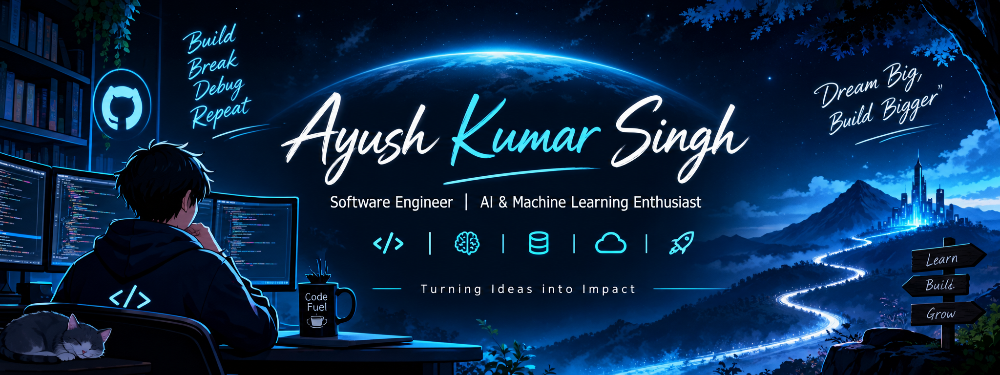

<div align="center">



<a href="https://git.io/typing-svg">
  
</a>

<br/>

<a href="https://github.com/ayushrajput1107">
  
</a>
<a href="https://linkedin.com/in/ayush-singh-373277345">
  
</a>
<a href="mailto:ayush.singh21379@gmail.com">
  
</a>

</div>

---

## `$ whoami`

I'm **Ayush Kumar Singh**, a Computer Science and Engineering student specializing in Data Science, interested in building software that is useful, scalable, and intelligent.

I enjoy working across the stack — from designing backend APIs and developing web applications to experimenting with machine learning models and AI-powered tools.

I believe strong engineering comes from understanding the fundamentals, solving meaningful problems, and being willing to debug what doesn't work.

```text
> Engineering mindset : Understand the problem first
> Current interests   : Backend systems, AI & ML
> Problem solving     : C++ | Data Structures & Algorithms
> Learning philosophy : Build → Break → Debug → Improve
```

## ⚡ What I'm working toward

<table>
  <tr>
    <td width="50%" valign="top">
      <h3>⚙️ Software Engineering</h3>
      Building web applications, REST APIs, backend services, and database-driven systems with an emphasis on clean code and maintainability.
    </td>
    <td width="50%" valign="top">
      <h3>🤖 AI & Machine Learning</h3>
      Exploring data preprocessing, model development, NLP, large language models, RAG, and practical AI applications.
    </td>
  </tr>
  <tr>
    <td width="50%" valign="top">
      <h3>🧠 Problem Solving</h3>
      Practicing DSA in C++, exploring algorithms, and strengthening the fundamentals behind efficient solutions.
    </td>
    <td width="50%" valign="top">
      <h3>☁️ Data & Cloud</h3>
      Learning data analysis, cloud technologies, and the tools needed to build and deploy useful applications.
    </td>
  </tr>
</table>

## 🚀 Selected projects

### 🎟️ Event Management System
A project inspired by the registration and QR-code pass workflow used at my college's first fresher fest. The idea was to explore how event registration and management could be handled through a dedicated application.

**Focus:** Event workflows · Registration · User experience

### 🧠 Personal AI Assistant
An exploration of building an AI-powered assistant that brings useful capabilities together through a software application.

**Focus:** AI integration · Application development

### 📊 Machine Learning Projects
A collection of experiments involving data preprocessing, exploratory data analysis, model building, and evaluation.

**Focus:** Python · Data analysis · Machine learning

> 📌 Add links to your actual repositories above once you've chosen the projects you want visitors to explore first.

## 🛠️ Tech stack

### Languages


### Web & Backend


### Data Science & Machine Learning


### Tools & Platforms


## 📈 GitHub activity

<div align="center">


<br/>


</div>

## 🤝 Let's connect

I'm always interested in connecting with developers, learning from different approaches, discussing software engineering, and collaborating on meaningful projects.

<div align="center">

<a href="https://linkedin.com/in/ayush-singh-373277345">LinkedIn</a> •
<a href="mailto:ayush.singh21379@gmail.com">Email</a> •
<a href="https://github.com/ayushrajput1107">GitHub</a>

<br/><br/>

*"Great software is built one thoughtful decision at a time."*

</div>
